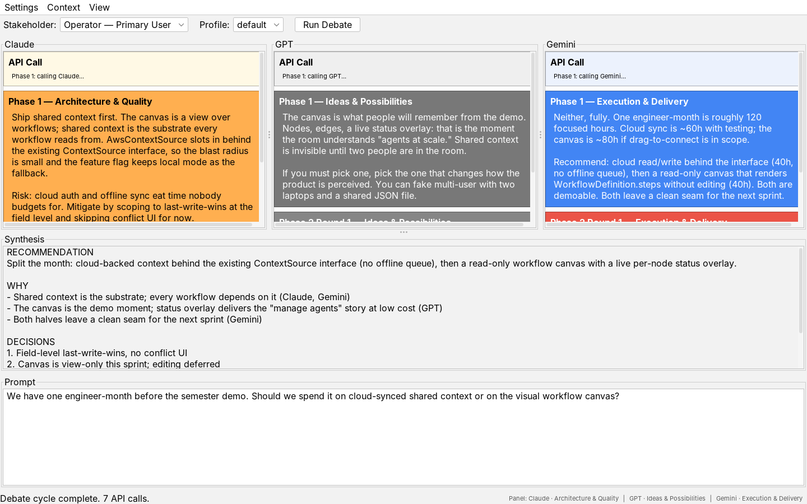
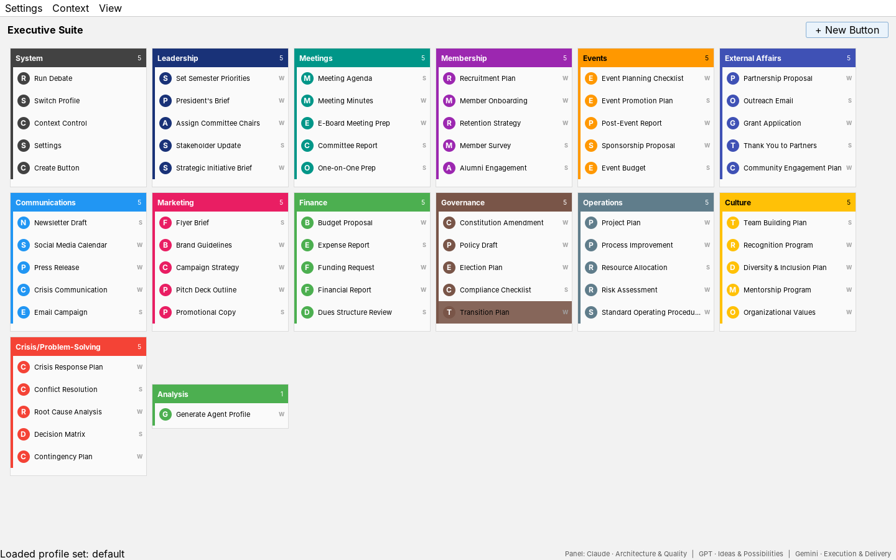
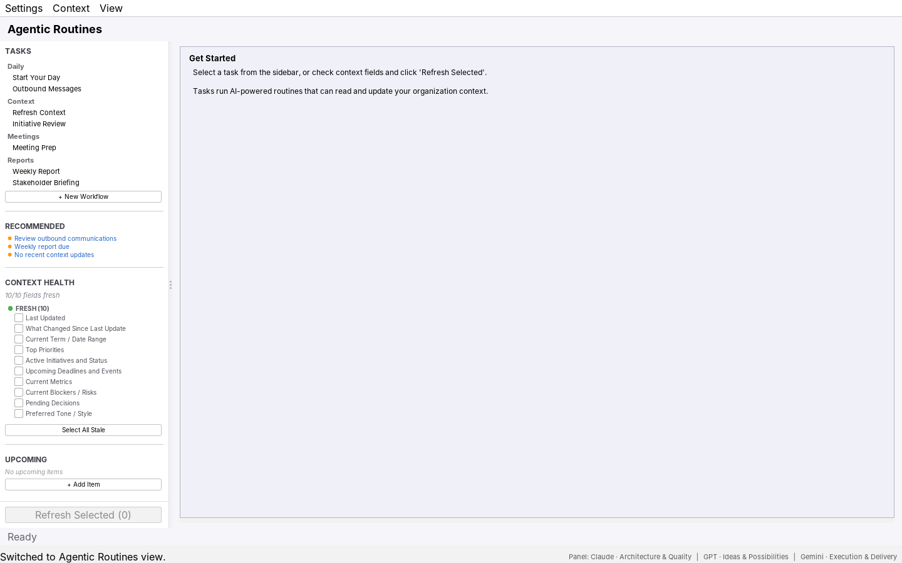

# AI Collab

**One question. Three frontier models. A real argument, then a decision.**

AI Collab is a Java desktop app where Claude, GPT, and Gemini answer the same prompt independently, read each other's answers, push back, and then converge on a synthesized recommendation. It started as a university final project and grew into a working prototype of something larger: a shared workspace where a leadership team and a panel of AI agents operate from the same organizational context.



*Debate view. Each column is one model. Phase 1 is the independent answer, Phase 2 is the reaction to the other two, and the Synthesis pane is the final recommendation. Transcript shown is illustrative.*

---

## The problem

Leaders who use AI seriously end up with the same bad workflow. Open three tabs. Paste the same question into each. Read three confident answers that quietly disagree. Reconcile them by hand. Re-explain the organization, the quarter, and the stakeholders every single time.

Two things are broken in that loop:

1. **No single model is the panel.** Each one has a house style and blind spots. The value is in the disagreement, and nobody is surfacing it.
2. **Context never accumulates.** Every prompt starts from zero. The organization's priorities, blockers, and relationships live in the user's head, not in the tool.

AI Collab is a bet that both problems have the same fix: treat the models as a panel, and give the panel a shared, living memory of the organization.

---

## The vision, in three stages

| Stage | What it means | Status |
|---|---|---|
| **1. Panel of experts** | Three models with distinct mandates debate one prompt and synthesize a recommendation. | Built |
| **2. Prompt board** | Leaders stop writing prompts. They press a button, answer two or three questions, and the system assembles the prompt with the right context attached. | Built, maturing |
| **3. Shared agent workspace** | Teams share one cloud-synced organizational context. Agents run routines against it, propose updates, and flag when people are misaligned. | Designed, partially built |

Each stage is useful on its own. Each one makes the next one possible.

---

## Stage 1: Panel of experts (today)

The core loop is a three-phase debate cycle orchestrated by `Maestro`:

1. **Independent.** The prompt goes to Claude, GPT, and Gemini in parallel. None of them sees the others.
2. **Reaction.** Each model receives the other two answers and reacts: agree, challenge, or refine. The number of reaction rounds is configurable.
3. **Synthesis.** One model reads all six outputs and the active stakeholder's profile, then writes a structured recommendation with decisions and open risks.

What makes the debate worth reading is that the models are not interchangeable. Each one carries an agent identity that shapes how it argues:

- **Claude** owns architecture and quality. It asks what breaks and what the blast radius is.
- **GPT** owns ideas and possibilities. It pushes on what would change how the product is perceived.
- **Gemini** owns execution and delivery. It converts ambition into hours and sequencing.

Every API call carries a layered context: team context, the agent's identity, the active stakeholder's profile, the organization context, and the task itself. The prompt engineering is the product. The HTTP plumbing is interchangeable.

**A real example.** The first thing the panel debated was this project's own roadmap. All three agreed the monolithic prototype had to be refactored and that manual JSON parsing was a time bomb. They disagreed on how aggressively to refactor and whether to use files or a database for persistence. The insight that emerged, which no single model offered alone, was the "learning curve tax": asking a student team to learn Maven, Jackson, JDBC, and JavaFX at the same time was the single biggest execution risk. That reshaped the plan. Minimize new technology, maximize what Java 21 ships with.

---

## Stage 2: Prompt board (built, maturing)

Most of what a leader asks AI for is routine: a meeting agenda, a stakeholder update, a budget proposal, a crisis response plan. Typing a careful prompt for each one is the tax that keeps people from using the panel at all.

The Executive Suite replaces typing with a board of task buttons, grouped by category.



*Executive Suite. Each button is a task template. The small letter on the right marks it as a single-call task (S) or a full debate (W). Buttons can be created by hand or with AI assistance.*

Press a button and the system does the rest:

- **Follow-up questions.** A short form captures the specifics the template needs. The user answers questions, not writes prompts.
- **Assembly.** Task, style instructions, answers, and organization context are combined into one prompt.
- **Routing.** Simple tasks go to a single model. Judgment calls go to the full panel.

There are 60+ default buttons across 12 categories, and users can create their own, including with an AI-assisted button creator that drafts the template and questions from a one-line description.

**What's next here:** conditional questions, per-button run history with one-click re-run, and exporting button sets so a team can share its library.

---

## Stage 3: Shared agent workspace (designed, partially built)

This is where the project is headed and where most of the recent work has gone.

The idea: an organization has a single, structured context (priorities, initiatives, blockers, deadlines, metrics, relationships, pending decisions). That context is the ground truth every agent reads from and every routine writes back to. It is shared across the team and it tracks its own freshness.



*Agentic Routines. Built-in routines on the left, recommended next actions in the middle, and context health below. Stale fields can be selected and refreshed by an agent.*

**What exists today, running locally:**

- **Organization context with freshness tracking.** Every field has a time-to-live. The UI shows what is fresh, what is stale, and what an agent should refresh.
- **Reconciliation service.** Agents do not write to context directly. They propose changes. Low-risk changes auto-apply. Everything else lands in an approval queue with an audit trail.
- **Seven built-in routines.** Start Your Day, Outbound Messages, Context Refresh, Meeting Prep, Initiative Review, Weekly Report, Stakeholder Briefing.
- **User-defined workflows.** A prompt template, a choice of context layers, and an output format, saved and registered like a built-in.
- **Recommendation engine.** Surfaces next-best actions based on staleness, the operational feed, and the change log.
- **Structured stores.** Initiatives, relationships, operational feed items, sessions, and a change log, all persisted as local JSON.

**What's designed and not yet built:**

- **Cloud-synced context.** The `ContextSource` interface already abstracts storage. A cloud implementation drops in behind it, with field-level last-write-wins and offline fallback.
- **Alignment agent.** A long-running agent that compares what different team members believe about priorities and risks and flags conflicts before they become decisions.
- **Tool-using agents.** Routines that run a real agentic loop: read context, find the gap, propose an update, wait for approval, write back.
- **Workflow canvas and monitoring.** A node-and-edge view of multi-step workflows with live run status, plus an execution log with cost per workflow.

The full design, including data models and sequencing, is in [`docs/archive/product-roadmap.md`](docs/archive/product-roadmap.md).

---

## Architecture

The codebase is plain Java 21 with Maven, Swing with FlatLaf, and Gson. No frameworks. Three extension points do most of the work:

- `LlmClient` is the one-method interface every provider implements. `Maestro` orchestrates the debate against it and never knows which provider it is talking to.
- `ContextSource` is the storage boundary for organization context. Local JSON today, cloud tomorrow, with no changes above the interface.
- `AgenticTask` is the contract for a routine. Register one and it appears in the sidebar.

The three provider clients are intentionally repetitive. They follow the same build, send, parse shape with small differences. Read one and you understand all three. That was a deliberate choice for a team with mixed Java experience, and it held up.

```
src/main/java/collab/
├── Maestro, LlmClient, AnthropicClient, OpenAiClient, GeminiClient   debate engine
├── PromptBuilder, PromptTemplate, ProfileSet, AgentProfile            layered context
├── ButtonPanel, SuiteButton, TaskContext, TaskQuestionDialog          prompt board
├── OrganizationContext, ContextSource, ReconciliationService          shared context
├── AgenticTask, AgenticTaskRegistry, *Task, WorkflowDefinition        routines
└── MainGui, AgenticRoutinesPanel, *Dialog                             Swing UI
```

---

## What the project taught

- **Disagreement is the feature.** A single model's answer feels complete. Three answers that conflict force the actual decision into the open. The synthesis is useful precisely because it has to name who said what and why.
- **Context is the moat, not the model.** Provider APIs change every quarter. The layered context design did not change once the shape was right. That is where the compounding value lives.
- **Agents need a reconciliation layer before they need autonomy.** The approval queue was not glamorous to build. It is the reason an agent can be trusted to touch organizational truth at all.
- **Constrain the stack to match the team.** The panel's "learning curve tax" warning was correct. Shipping on built-ins kept four people productive on one codebase.

---

## Run it

Requires Java 21 and Maven.

```bash
mvn compile exec:java
```

On first launch the app asks for API keys for Anthropic, OpenAI, and Gemini and writes them to a git-ignored `config.properties`. See `config.properties.example` for the full list of settings, including model names and the number of debate rounds.

Each full debate makes seven API calls. The app shows a running count so cost stays visible.

**Stack:** Java 21 · Maven · Swing (FlatLaf) · Anthropic, OpenAI, and Gemini APIs · Gson

---

## Status and related work

Active. The button-driven task layer originally built here was also split into a standalone project, [`cowork-suite`](https://github.com/grant-hauskins/cowork-suite). The original roadmap, development philosophy, and the single-file v0.3 prototype are preserved in [`docs/archive`](docs/archive/).

MIT licensed.
